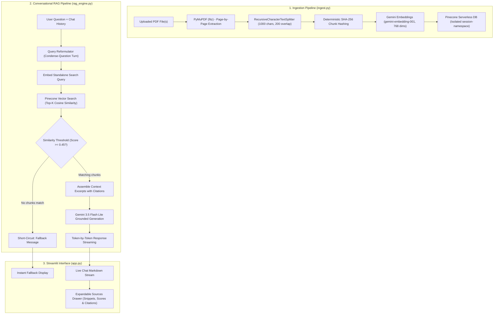

# 📄 PDF Q&A System — Retrieval-Augmented Generation (RAG)

An enterprise-ready, end-to-end PDF Question Answering system built with **LangChain · Google Gemini · Pinecone Serverless · Streamlit**.

---

## 🌐 Official Resources & Documentation Links

* **Google Gemini API / AI Studio**: [https://aistudio.google.com/](https://aistudio.google.com/)
* **Pinecone Vector Database**: [https://www.pinecone.io/](https://www.pinecone.io/)
* **LangChain Framework**: [https://python.langchain.com/](https://python.langchain.com/)
* **Streamlit Documentation**: [https://streamlit.io/](https://streamlit.io/)
* **PyMuPDF Documentation**: [https://pymupdf.readthedocs.io/](https://pymupdf.readthedocs.io/)

---

## 🔄 Project Workflow Architecture



---

## ✨ Features

| Feature | Technical Implementation |
|---|---|
| **Multi-PDF Ingestion** | In-memory stream processing via `PyMuPDF` preserving page-level metadata. |
| **Smart Text Chunking** | `RecursiveCharacterTextSplitter` prioritizing paragraph and sentence boundaries. |
| **Deduplication Engine** | SHA-256 chunk hashes check Pinecone before upserting, preventing redundant embeddings. |
| **Multi-Tenant Isolation** | Dynamic Pinecone namespaces (`session-<uuid>`) provide logical data isolation per user. |
| **Dense Vector Embeddings**| High-performance 768-dimensional embeddings via Google Gemini API. |
| **Similarity Thresholding**| Chunks scoring below `0.45` cosine similarity are dropped to eliminate irrelevant noise. |
| **Conversational Memory** | Follow-up questions are reformulated into standalone search queries using past turns. |
| **Hallucination Guardrails**| Strict system prompt instructions enforce inline citations `[Filename, Page X]` and deterministic fallback. |
| **Token Streaming UI** | Streamlit chat UI streams response tokens live via Python generators. |
| **Source Attribution** | Expandable card drawer per answer displays chunk content, page citations, latency stats, and similarity scores. |
| **Evaluation Suite** | Standalone benchmark (`evaluate.py`) measures retrieval latency, generation latency, and citation accuracy. |

---

## 🗂 Project Structure

```
pdf Q&A using RAG/
├── app.py              # Streamlit web application (main UI entry point)
├── ingest.py           # PDF parsing, chunking, deduplication & Pinecone indexing
├── rag_engine.py       # Conversational retrieval, query condensation & LLM generation
├── evaluate.py         # Automated evaluation and latency/citation benchmarking
├── config.py           # Centralized environment variable validator and configuration
├── run_app.bat         # One-click Windows virtual environment launcher
├── requirements.txt    # Pinned Python package dependencies
├── .env.example        # Environment variable template (safe to commit)
├── .gitignore          # Git exclusion rules (protects .env and .venv)
└── README.md           # Project documentation and setup guide
```

---

## 🔧 Prerequisites

* **Python**: 3.10 to 3.13
* **Google Gemini API Key**: [Get a Gemini API Key](https://aistudio.google.com/app/apikey)
* **Pinecone Account**: [Get a Pinecone API Key](https://app.pinecone.io/) (Free Serverless Starter Tier)

---

## 🚀 Quick Setup & Installation

### 1. Clone the Repository
```bash
git clone <your-repository-url>
cd "pdf Q&A using RAG"
```

### 2. Set Up Virtual Environment

**On Windows:**
```powershell
python -m venv .venv
.\.venv\Scripts\activate
```

**On macOS / Linux:**
```bash
python3 -m venv .venv
source .venv/bin/activate
```

### 3. Install Dependencies
```bash
pip install -r requirements.txt
```

### 4. Configure Environment Variables
Copy the template file to create your `.env`:
```bash
cp .env.example .env
```

Open `.env` in any text editor and fill in your keys:
```env
# Google Gemini API Key
GOOGLE_API_KEY=your_gemini_api_key_here

# Pinecone Vector DB
PINECONE_API_KEY=your_pinecone_api_key_here
PINECONE_INDEX_NAME=pdf-qa-rag

# Model Settings
GEMINI_GENERATION_MODEL=gemini-3.5-flash-lite
GEMINI_EMBEDDING_MODEL=models/gemini-embedding-001
EMBEDDING_DIMENSIONS=768

# Retrieval Parameters
RAG_TOP_K=5
RAG_SCORE_THRESHOLD=0.45
RAG_CHUNK_SIZE=1000
RAG_CHUNK_OVERLAP=200

# Pinecone Serverless Spec
PINECONE_CLOUD=aws
PINECONE_REGION=us-east-1
```

> **Security Note:** Never commit your actual `.env` file to version control. The `.gitignore` file is configured to exclude `.env`.

---

## ▶️ Running the System

### Option A: One-Click Launcher (Windows)
Double-click `run_app.bat` or run in terminal:
```cmd
run_app.bat
```

### Option B: Streamlit CLI
Run directly using the virtual environment executable:
```bash
.\.venv\Scripts\streamlit.exe run app.py
```
Open your browser at `http://localhost:8501`.

---

## 📖 Application Usage Workflow

1. **Upload Documents**: Drag and drop one or more PDF files into the sidebar uploader.
2. **Index Documents**: Click **🚀 Index N new PDF(s)**. The system extracts pages, generates chunk hashes, embeds text, and upserts vectors into Pinecone.
3. **Ask Questions**: Type your question in the chat bar (e.g. *"What is SQL?"*).
4. **Inspect Sources**: Expand **"📚 Retrieved Sources & Confidence Scores"** under the response to review chunk snippets, page citations, similarity percentages, and latency metrics.
5. **Session Reset**: Use the sidebar buttons to **Clear Chat** or **Clear Index** at any time.

---

## 📊 Evaluation & Benchmarking

To benchmark retrieval latency, generation speed, and citation accuracy:

```bash
python evaluate.py --namespace <your-session-namespace>
```

You can also pass custom test suites in JSON format:
```bash
python evaluate.py --namespace <your-session-namespace> --cases-file test_cases.json --output evaluation_results.csv
```

**Metrics Evaluated:**
* Average retrieval latency (seconds)
* Average generation latency (seconds)
* Average total round-trip time
* Source citation accuracy (% of queries citing expected document)
* Keyword coverage accuracy (% of queries containing expected domain terms)

---

## 🛡 Grounding & Hallucination Guardrails

1. **Strict Zero-Shot Grounding**: The prompt instructs the LLM to answer solely from provided context excerpts.
2. **Similarity Threshold Filtering**: Chunks with cosine similarity `< 0.45` are discarded.
3. **Zero-Chunk Short-Circuiting**: If no chunks pass the threshold, the LLM call is bypassed completely, returning:
   > *"I cannot find this information in the uploaded documents."*
4. **Mandatory Inline Citations**: Claims must cite the exact source in the format `[Filename, Page X]`.

---

## 📋 Troubleshooting Common Issues

| Issue / Error | Cause | Solution |
|---|---|---|
| `ModuleNotFoundError: No module named 'fitz'` | App was launched using global Python instead of project `.venv`. | Run using `run_app.bat` or `.\.venv\Scripts\streamlit.exe run app.py`. |
| `429 RESOURCE_EXHAUSTED` | Exceeded Gemini Free Tier 100 embedding requests/min limit. | Wait 30–60 seconds before re-querying or uploading another large PDF. |
| Blank or Empty Assistant Response | LLM returned an empty string or all chunks were below threshold. | Built-in fallback automatically renders: *"I cannot find this information in the uploaded documents."* |
| `pinecone.exceptions.PineconeApiException: 404` | Pinecone index has not initialized yet. | The index is auto-created on the first run; allow ~30 seconds for AWS Serverless provisioning. |

---

## 👨‍💻 Author & Maintainer

* **Sandeep Kumar** ([@Sansmith11](https://github.com/Sansmith11))

---

## 📜 License

This project is licensed under the MIT License — free for educational, personal, and commercial use.
